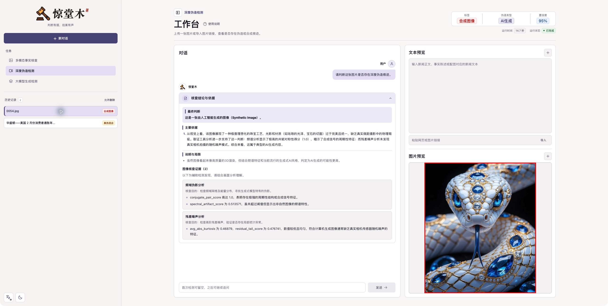

  
  <h1>惊堂木</h1>
  
<strong>判断有据，拍案有声。</strong>

  
面向新闻、社交媒体帖子与图片的真实性核查演示平台

  

    <a href="http://39.97.240.173:5010/">在线体验</a> ·
    <a href="#快速上手">使用指南</a> ·
    <a href="docs/demo-video/sample/README.md">演示样例</a>
  

惊堂木支持文字与图文事实核查，以及单张图片的伪造检测。输入待核查内容后，可以查看真实性判断、主要问题类型和分析依据，再围绕同一份结果继续追问。

## 在线体验

**[打开惊堂木在线 Demo →](http://39.97.240.173:5010/)**

访问地址：<http://39.97.240.173:5010>

使用浏览器即可体验，无需在本地部署。界面支持中文、英文及明暗主题切换。

*工作台实景：查看检测标签、图片预览、分析依据与工具证据。*

## 体验哪些功能

| 任务入口 | 提交内容 | 可以查看的结果 |
| --- | --- | --- |
| **多模态事实核查** | 新闻正文或事实陈述，可附最多 4 张图片 | 五分类真实性判断、主要问题，以及文本和图文关系的核查依据；仅提交文字时进行纯文本核查 |
| **深度伪造检测** | 单张图片 | 真实、伪造或合成判断、伪造方式分析及可疑区域提示（如有） |

- **直接输入或导入素材**：支持粘贴文字、上传 TXT、上传图片，以及导入网页或图片链接。
- **提交前确认内容**：检查导入的正文和图片预览，移除不需要参与核查的配图。
- **查看证据与疑点**：展开“核查结论与依据”，阅读最终判断、主要依据、说明与局限，以及实际检索来源或图像核查发现。
- **围绕结果继续追问**：询问具体疑点、证据支持范围或可疑区域，逐步理解本次判断。
- **回看历史与图片细节**：恢复历史检测记录，放大查看图片及区域标注。

“大模型生成检测”入口暂未开放。

## 快速上手

1. **选择任务**：打开在线 Demo，选择“多模态事实核查”或“深度伪造检测”，新建对话。
2. **准备素材**：事实核查填写正文或导入网页，按需附加图片；图像检测上传一张图片或导入图片链接。检查正文与图片预览后再提交。
3. **开始检测**：点击“开始检测”。首次检测时，对话框可以留空；有重点关注的问题，也可以先填写。
4. **阅读结果**：查看标签、伪造类型、置信度和运行状态，展开“核查结论与依据”了解解释与证据。图片支持点击放大。
5. **继续追问**：在对话框输入问题并发送。侧栏“历史记录”可重新打开已有检测；需要检测另一份内容时，新建对话。

可以这样追问：

> 哪个核心主张最值得进一步核实？已有证据支持到什么程度？

> 你指出的图片异常在哪里？哪些是直接观察，哪些来自辅助检测？

## 如何理解结果

### 事实核查标签

| 标签 | 中文显示 | 判断含义 |
| --- | --- | --- |
| `True` | 真实 | 核心主张得到可靠证据支持，未发现实质错误或误导 |
| `Mostly True` | 大部分真实 | 主体结论成立，存在不改变主要结论的局部错误或误导 |
| `Mixture` | 真伪混合 | 真实与虚假成分同时对主要结论产生实质影响 |
| `Mostly False` | 大部分虚假 | 主要结论不成立，仍保留少量真实信息 |
| `False` | 虚假 | 全部或几乎全部核心主张被可靠证据反驳 |

### 图像检测标签

| 标签 | 中文显示 | 判断含义 |
| --- | --- | --- |
| `Real_Image` | 真实图像 | 真实拍摄，未发现改变关键内容的编辑 |
| `Forged_Image` | 伪造图像 | 以真实图片为基础，通过替换、拼接、删除或重绘等方式改变内容 |
| `Synthetic_Image` | 合成图像 | 主体画面主要由生成、渲染或其他合成方式产生 |

“伪造类型”概括本次发现的主要问题，例如事实虚构、错误语境、图文冲突、内容替换或 AI 生成。“无”表示未发现相应风险，“未知”表示尚不能确定具体类型。

阅读结果时，也请留意：

- **置信度**表示模型对本次判断的把握程度，应结合证据阅读，不宜直接当作真实性概率。
- **检索证据**是实际获得的候选来源，点击标题可核对原始材料；搜索结果本身仍需结合语境判断。
- **图像核查证据**展示辅助检测的目的与关键发现，应结合直接画面分析理解。
- **区域标注**用于定位复核重点，部分红框属于近似估计，应结合文字说明查看。
- **说明与局限**会列出证据不足、冲突或无法核实的部分。检测失败应重新尝试，不作为真伪结论。

## 体验说明

在线 Demo 会保留检测历史，已提交内容可能被其他访问者看到，请使用可公开分享的素材。结果用于辅助核查；涉及重要事实时，请进一步核对原始来源。

检测耗时会随内容、图片数量和检索情况变化。网页导入失败时，可以直接粘贴正文并上传本地图片；页面显示检测失败时，可稍后重试。
